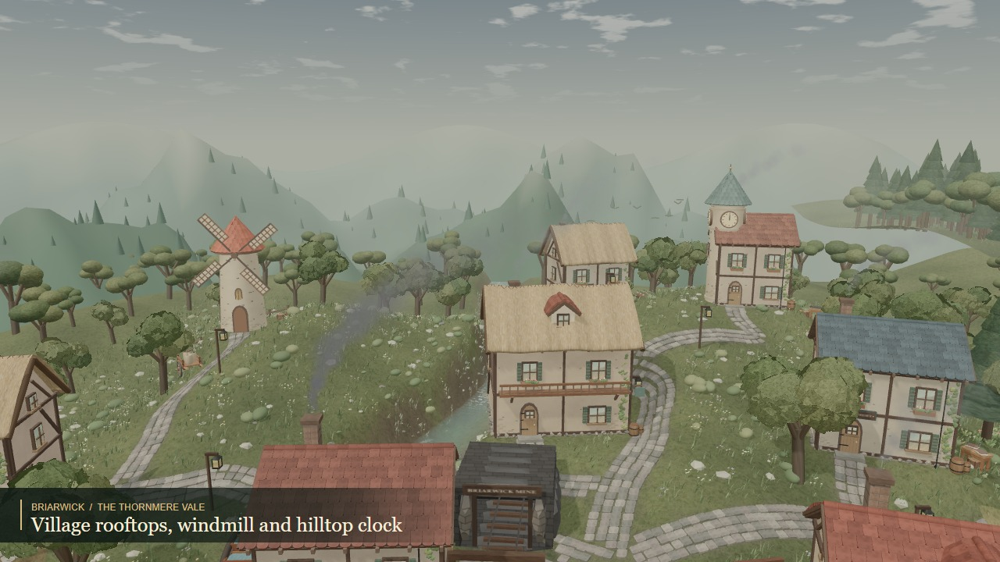

# CodeWorld · Briarwick

Briarwick is a playable Three.js world set in Thornmere Vale. Follow the brook from a working mill to the village, sail Alder Lake, run a farm, or descend through the crypts and ride a loaded ore cart back to the blacksmith.

**[Play Briarwick in your browser](https://docdamage.github.io/CodeWorld/#play)** · **[Start the full interactive tour](https://docdamage.github.io/CodeWorld/#tour)**

Play starts you on foot in the village. The tour takes you through all 61 stops. Choose **Walk here** to explore at any point, then **Resume tour** to pick up where you left off. Returning visitors can start over from **Places → Restart tour**.

## Watch the world tour

[](https://docdamage.github.io/CodeWorld/tour.html)

**[Watch the recorded tour in your browser](https://docdamage.github.io/CodeWorld/tour.html)** · 5 min 38 sec · 61 stops. The recording follows one complete loop at normal speed. Each view is labeled, and the player lets you jump to any of the seven chapters.

| Time | Places and activities |
| --- | --- |
| 0:00 | **Briarwick village.** Cross the brook, watch the mill wheel, and step inside eight furnished buildings, including Bramble Bakery, the Bindery, the windmill, and Brook Armory. The armory’s sluice controls the water that drives its machinery. |
| 1:04 | **Commons Farm.** Till, plant, water, and harvest twelve crops. Milk the cows, collect eggs, and feed the livestock. Drive the tractor, work the plow, and hitch a wagon to bring produce back to the barn. |
| 1:55 | **Alder Lake and the falls.** Board the sailboat at the jetty, trim the sail to the wind, or switch to the motor or oars. Anchor to fish for 30 kinds of fish and aquatic life. A perch and a pike fight differently. Ease the drag during a run and take up slack as the fish tires. Watch fish schools, frogs, turtles, insects, herons, and kingfishers through binoculars, or skip stones from shore. |
| 2:29 | **Pinewood wilderness.** Follow the trail through Alder Glade, Fern Hollow, High Pines, and Bracken Meadow. Watch or hunt 20 woodland species, from red squirrels to fallow deer, and record encounters in the field journal. |
| 2:56 | **Thornmere Castle.** Operate the drawbridge, walk the battlements, and explore the great hall, royal library, treasury, and king’s chamber. The prison galleries lead deeper into the castle. In the vault you can meet Aurelith, speak with the dragon, and earn its friendship. |
| 4:27 | **The Briar Crypts.** Descend through the Bell Crypt, Sunken Rotunda, Ossuary Gallery, and Chapel of the Watchers to the Nameless Sanctum. The mine begins beneath the sanctum. |
| 5:06 | **Ore railway and forge.** Mine iron, copper, tin, and silver, fill the cart, then drive the rails back to the armory yard. Unload the ore, smelt it into bars, and forge an iron pick, bronze sickle, or master pick. Better picks collect more ore per swing, and the sickle increases the hand harvest. |

Outside, gusts bend grass, crops, and tree canopies. Rain soaks into soil, fills hollows, and drains downhill into the brook. The rising current changes the mill’s speed. Look for boot, paw, and hoof prints in soft ground, or change the time and weather to see the valley in lantern light, fog, or snow.

## Play locally

With Node.js and npm installed, run these commands from the repository root.

```sh
npm ci
npm run build
npm start
```

Open the [village](http://127.0.0.1:4173/) or [start the interactive tour](http://127.0.0.1:4173/#tour) in a WebGL 2 browser. **Places** lets you jump directly to a destination. The lake and hunting journals, farm progress, and mine and forge inventories are saved in this browser.

### Take over the tour

Choose **Walk here**, press Escape, or use the controller’s B / ○ button to start playing at the current shot. An aerial view puts you on nearby walkable ground, an interior keeps you in the room, and an open-water view puts you aboard the sailboat. Choose **Resume tour** to return to the same moment and speed, even after a reload in the same browser. **Tour speed** ranges from 0.25× to 4×. Select **Paused** to hold the camera while the world keeps moving.

| Action | Desktop controls |
| --- | --- |
| Explore | WASD or arrow keys to walk, Shift to run, drag to look, E to interact |
| Adjust or restart the tour | `[` and `]` change speed. **Places → Restart tour** starts a fresh loop. |
| Fish, watch wildlife, or skip stones at the lake | 1–3 to select gear, F to use it. During a fight, hold F to reel and use `[` or `]` to adjust drag. |
| Sail | E to board or dock, A/D to steer, W/S to trim or drive, Q to switch propulsion, Space to anchor |
| Use a controller or touch screen | Open **?** for controls. Context prompts identify available actions. Controller bumpers adjust tour speed. |

Run `node --test` to check the game logic. Run `npm run build` after editing the source to rebuild the browser bundle.
